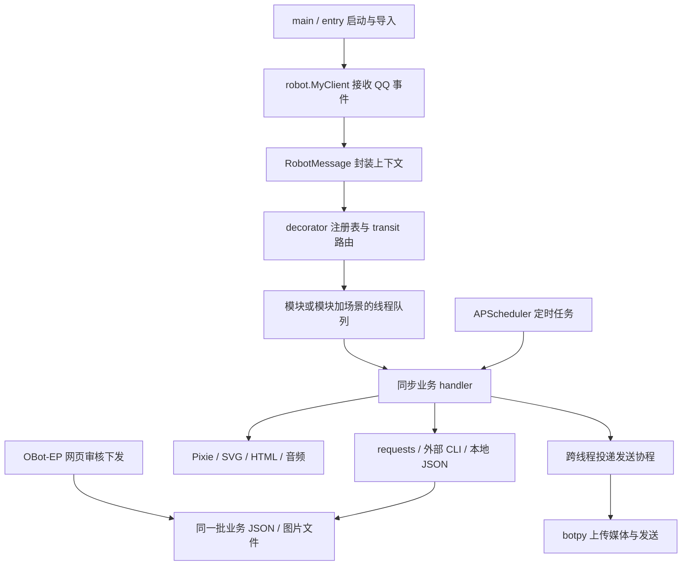

# OBot ACM → NoneBot2：结构研究与迁移设计

研究日期：2026-10-11。当前交付是代码研究与设计，未开始业务迁移，未改动线上服务。

**建议保留已有业务算法、Pixie 组件和 OBot-EP 页面，把机器人与网页共同依赖的数据、权限和业务操作抽成应用服务。NoneBot 负责 QQ 事件接入和指令执行，OBot-EP 继续负责网页交互。** 首先解决双端写入、身份作用域和阻塞任务，再逐插件迁移。

## 1. 研究范围与结论依据

| 对象 | 本次基线 | 核查范围 |
|---|---|---|
| 旧机器人 | `F:/OBot-ACM`，main `530f1518e9764a7c3ae194c5c0ccddec76e6d393` | 入口、核心、19 个业务模块、平台访问、数据层、渲染、测试；74 个 Python 文件，12,994 行静态清单 |
| 新机器人 | `F:/OBot-ACM-nonebot` | 已安装 NoneBot2 2.5.0、QQ adapter 1.7.3、Python 3.12；已有 `/ping` 和官方 QQ Webhook 部署基线 |
| Dashboard | [OBot-EP 固定版本](https://github.com/Floating-Ocean/OBot-EP/tree/3e417697c31934008fd32ac7ca06f923b31ffd98) | 框架、两个实际插件、认证/审核/下发、前端路由和测试；53 个非模板 Python 文件，12,131 行，63 个 router 注册项 |
| 旧迁移探索 | `origin/dev-nonebot`、`origin/refactor-nonebot` | 参考已有 help registry 和权限插件；不能当作当前主线的完整迁移结果 |

用户已修正 dashboard 位置：它在独立的 **OBot-EP** 仓库，不在 OBot-ACM 内。本次以该仓库实际源码为准；其 README/AGENTS 的“只有 PickOne”描述已落后于代码，当前还有 `contestlist`。

机器清单：[旧源码索引](F:/OBot-ACM-nonebot/docs/research/source-inventory.json)、[注册原始数据](F:/OBot-ACM-nonebot/docs/research/command-inventory.json)、[可读指令清单](F:/OBot-ACM-nonebot/docs/research/commands.md)、[EP 源码与接口索引](F:/OBot-ACM-nonebot/docs/research/ep-inventory.json)。旧项目共有 **53 个 command 处理函数、1 个 hook、3 个 scheduled 声明**；不是 53 个最终用户命令，别名、子命令和任务目标还会展开。

研究使用静态分析和两个隔离函数复现。没有读取 `.env.dev`，没有启动旧机器人、访问真实用户数据或运行会写真实数据的 EP 演练，也没有修改旧项目。研究初期若干子模块缺少工作树文件；最终复核时本地子模块已完整、旧仓库状态为空，父仓库 HEAD 未变，本任务没有执行恢复或更新操作。已补核 Peeper `e576448` / v1.2.5 的入口、Hydro 抓取、数据模型、缓存与渲染，见 3.4；统计清单的 74 个文件不包含这些子模块。

NoneBot 的异步处理能力适合这个方向，但**仅替换框架不会自动改善并发，也不能增加腾讯开放平台未授予的权限**。API 覆盖应逐项对照旧 botpy fork 与已安装 QQ adapter；本次没有做性能压测，不能给出提升倍数。

## 2. 当前结构与真实调用链



核心职责及迁移处理：

| 当前位置 | 实际职责与耦合 | 建议去向 |
|---|---|---|
| [main.py](F:/OBot-ACM/main.py)、[entry.py](F:/OBot-ACM/entry.py) | 守护、预加载、资源准备、导入注册 | 进程守护交给现有 systemd；资源在生命周期中准备 |
| [robot.py](F:/OBot-ACM/robot.py) | QQ 事件入口、维护指令、scheduler 激活 | QQ 适配边界、运维插件、JobService 分开 |
| [constants.py](F:/OBot-ACM/src/core/constants.py) | 配置、凭据、日志、版本、运行状态、帮助、闲聊集中在一个类，读取发生于导入期 | 类型化配置、SecretProvider、BuildInfo、RuntimeState、CommandCatalog 分拆 |
| [decorator.py](F:/OBot-ACM/src/core/bot/decorator.py:109) | 注册别名/权限/场景、前缀匹配、模块版本与 cron | 薄命令声明层生成 NoneBot matcher；统一 Catalog，不再维护另一套路由引擎 |
| [transit.py](F:/OBot-ACM/src/core/bot/transit.py:145) | 指令选择、线程队列、权限和部分业务开关、错误处理 | matcher + PolicyService + 有界工作队列；移除业务名称硬编码 |
| [message.py](F:/OBot-ACM/src/core/bot/message.py:176) | 身份、参数、权限快照、发送、媒体、图片变换、回复追踪 | RequestContext、MessageGateway、MediaService、SessionStore |
| [tools.py](F:/OBot-ACM/src/core/util/tools.py:30) | HTTP、进程、日期、转换、二维码混在一起 | IO 抽为 Client/Adapter；纯函数留在小型工具模块 |
| [json_storage.py](F:/OBot-ACM/src/data/model/json_storage.py:30) | JSON 反序列化和原子替换，缺完整读改写事务 | Repository + UnitOfWork；旧格式仅作为导入/兼容出口 |
| [render/pixie/model.py](F:/OBot-ACM/src/render/pixie/model.py:23) | 已有渲染基类、分块、列布局、资源缓存 | 保留布局组件，封装 RenderService 和 PixieBackend |

### 2.1 业务模块拆分清单

下表覆盖 `register_all_modules()` 中的全部 19 个模块；维护指令额外在 robot.py。

| 模块 | 功能与依赖 | 可共享的核心 / Dashboard 价值 |
|---|---|---|
| [cp/cf.py](F:/OBot-ACM/src/module/cp/cf.py) | CF 用户卡、题目、提交、比赛、预测、绑定和对战 | CodeforcesClient；Profile/Problem/Binding/Duel 服务；个人账号与对战历史 |
| [cp/atc.py](F:/OBot-ACM/src/module/cp/atc.py) | AtCoder 用户卡、比赛、随机题，部分借助 Clist | AtCoderClient + ClistClient；共享比赛/选题服务 |
| [cp/nk.py](F:/OBot-ACM/src/module/cp/nk.py) | 牛客个人/团队资料、比赛、榜单 | NowcoderClient；区分公开页面抓取与接口，页面变化可局部修复 |
| [cp/contest_manual.py](F:/OBot-ACM/src/module/cp/contest_manual.py) | MOD 导入比赛到 JSON | ContestRepository；直接衔接 EP contestlist |
| [cp/cpcfinder.py](F:/OBot-ACM/src/module/cp/cpcfinder.py) | XCPC 人员/奖项查询 | CPCFinderClient 返回 DTO；查询页可以复用 |
| [cp/oierdb.py](F:/OBot-ACM/src/module/cp/oierdb.py) | OI 姓名、学校、成绩、排名 | OIerRepository + SearchService；只读索引独立刷新 |
| [cp/peeper.py](F:/OBot-ACM/src/module/cp/peeper.py) | 多配置 OJ 榜单、历史/评测筛选、用户查询、每日更新推送 | PeeperCliAdapter + BoardService；私有榜单与任务状态 |
| [game/guess_interval.py](F:/OBot-ACM/src/module/game/guess_interval.py) | 场景内区间猜数字 | 纯状态机 + SessionStore；无需优先做网页游戏 |
| [game/guess_1a2b.py](F:/OBot-ACM/src/module/game/guess_1a2b.py) | 场景内 1a2b | 同上，保留游戏差异，不强行抽万能游戏引擎 |
| [game/tetris.py](F:/OBot-ACM/src/module/game/tetris.py) | 方块模拟、回退、计分和图片 | 纯规则 + 场景状态 + Renderer；可展示活跃会话数 |
| [stuff/color.py](F:/OBot-ACM/src/module/stuff/color.py) | 配色资源查询与色卡 | PaletteRepository；渲染主题可用其数据，但不能依赖聊天 handler |
| [stuff/git_cmd.py](F:/OBot-ACM/src/module/stuff/git_cmd.py) | Git 状态、更新、子模块、进程替换、更新回报 | 独立运维边界；网页先只读构建版本，不直接提供任意 shell/Git 操作 |
| [stuff/how_to_cook.py](F:/OBot-ACM/src/module/stuff/how_to_cook.py) | 本地菜谱检索、Markdown/HTML 图片 | RecipeRepository + HtmlRenderBackend；可提供菜谱浏览 |
| [stuff/mc.py](F:/OBot-ACM/src/module/stuff/mc.py) | MC 随机资源与文案 | MCResourceRepository + 文案函数；供“晚安”等调用 |
| [stuff/misc.py](F:/OBot-ACM/src/module/stuff/misc.py) | 比赛汇总/推送、帮助、版本、二维码、语音、一言、图片变换等 | 拆为 contest/help/about/media 与小功能插件；避免重新形成杂物模块 |
| [stuff/pick_one.py](F:/OBot-ACM/src/module/stuff/pick_one.py) | 图片检索/预览/上传/审核/OCR/点赞评论/统计 | AssetService、ModerationService、OCRService；与 EP PickOne 共用 |
| [stuff/rand.py](F:/OBot-ACM/src/module/stuff/rand.py) | random.org、选择、排序，转调 CF/ATC/颜色等 handler | RandomClient 与 ProblemService；去掉插件之间的 handler 调用 |
| [stuff/repeat.py](F:/OBot-ACM/src/module/stuff/repeat.py) | 全群消息 hook、复读判定、机器人回复去重 | EventObserver + TTL 状态；受事件订阅权限限制 |
| [stuff/uptime.py](F:/OBot-ACM/src/module/stuff/uptime.py) | UptimeRobot 外部状态页查询 | UptimeClient；不能当作机器人自身运行指标 |

### 2.2 需要保留但不能照搬的旧行为

- `/来只*`、`/选择*` 等前缀命令、无斜杠关键词、大小写别名、群内 @ 条件和私聊行为都需要兼容样例。普通 `on_command` 不会自动复刻所有旧 token 改写规则。
- `/rand cf`、`/rand atc` 直接调用另一模块 handler，“晚安”调用 MC handler。这种复用会绕开该 handler 原有入口规则；应转为共享业务操作。
- CF、ATC、NK 的子命令藏在一个分派函数内；新的帮助与权限要落到 `cf.duel.finish` 等实际动作，而不是只有 `cf` 一级。
- 游戏默认是同一个场景共同参与；新 QQ adapter 的群 `get_session_id()` 含用户 ID，直接替换会变成每人一盘。应显式区分 `SceneRef` 和个人会话键。
- 旧频道被动 uuid 用 guild_id，主动发送用 channel_id；频道私信的旧 key 也不一致。迁移应存显式映射，遇到一对多时列出待确认记录，不能猜测。
- 图片、语音、私聊、群聊、频道与主动推送分别验收；已通过 `/ping` 不代表这些能力都已通过。

## 3. 推荐的服务边界

术语约定：**Client** 封装外部网络服务；**Adapter** 对接 SDK、CLI 或旧数据格式；**Service** 承载可跨入口复用的业务；**Repository** 管理业务数据。不要把所有 helper 都命名成 Client，也不必把每一块都部署成网络服务。

### 3.1 优先抽取清单

| 公共能力 | 主要接口 / 返回内容 | 来源与关键约束 |
|---|---|---|
| HttpTransport | `request_json/text/bytes` | 替代 fetch_url；共享异步连接池、超时、按站点限流、有限重试；错误脱敏 |
| CF/ATC/NK/Clist/CPC/Uptime Clients | `get_profile/list_contests/list_submissions/...` → 类型化 DTO | 抓取、解析与网络异常在这里处理；不能返回 Pixie Image 或直接回复 QQ |
| ContestService | `list_contests(filters)` → 比赛列表 + 来源状态 + 更新时间 | 并行且限流地聚合来源；一个来源失败时保留其他结果，明确标记旧缓存 |
| ProfileService / ProblemService | 资料聚合、筛题、随机题 | `/cf`、`/rand cf` 与未来网页共用；CF rating 预测纯算法独立 |
| RenderService | `render(view, model, options)` → Artifact | 下节详述；统一排队、缓存和产物，不混入 QQ 上传 |
| AssetService / OCRService | 分类检索、上传、描述、统计、OCR 作业 | 从 PickOne 提取；扫描、去重、审核和文本识别分开 |
| ModerationService | `submit/review/preview/apply` | 沿用 EP 提交单与冲突处理概念；所有 Bot/Web 写入统一 |
| BoardService / PeeperCliAdapter | `get_board/query_user/refresh` → BoardSnapshot 或 Artifact | CLI argv、超时、隔离输出、返回码和错误 DTO；先保持外部生成器边界 |
| IdentityService / PolicyService | 身份解析、资源授权、权限解释 | QQ、Web、定时任务共用；见第 5 节 |
| MessageGateway / QQGateway | `reply/send_to/upload` → DeliveryReceipt | 屏蔽群/频道/C2C 差异；await 结果，记录平台消息 ID 和失败原因 |
| MediaService / AudioService | 图片变换、二维码、音频合成/编码 | CPU/文件工作在有界 worker；变换是显式策略，不能隐藏在基础发送中 |
| JobService / SessionStore | 后台任务、定时执行、会话 TTL | 作业与聊天对话分开；取消、去重、恢复、权限重查 |
| 配置、ArtifactStore、Telemetry | 校验/版本、产物生命周期、指标与审计 | 替代 Constants 大对象及时间戳缓存目录 |

HttpTransport 必须按照具体接口区分幂等性，不能对所有 POST 或消息发送盲目重试。旧 fetch_url 默认 POST，迁移时逐一确认各站接口使用的方法。缓存键含来源、查询条件、必要的可见性范围；提供容量和 TTL，并合并并发的同一请求。

不要强迫所有竞赛平台实现庞大统一基类。可按能力定义小接口 `ContestSource`、`ProfileProvider`、`ProblemProvider`、`SubmissionProvider`；例如 Uptime 无需具备随机题方法，NowCoder 团队字段也不应丢掉。这里“旧 HTTP helper 缺超时”指 Bot 的 `src/core/util/tools.py`；Peeper 自己的 helper 已有超时，不能混为一谈。

### 3.2 Pixie：保留组件，抽出稳定的渲染服务

可直接保留的基础是 `Renderer`、`RenderableSection`、`RenderableSvgSection`、`SimpleCardRenderer` 和各卡片 section；它们已经解决布局与多列均衡。需要拆开的部分是平台访问、`Constants`、资源路径、随机主题、输出文件和 QQ 回复。

建议内部层次：

```text
业务 DTO → ViewModel → Card/Section 组件 → PixieBackend → Artifact
                       Theme / FontCatalog / IconStore      ↓
                                                       QQ 或网页预览
```

对业务的设计接口（非当前已实现 API）：

```python
artifact = await renderer.render(
    view="contest.list",
    model=ContestListView.from_result(result),
    options=RenderOptions(theme="default", format="png", scale=1),
)
await messenger.reply(context, image=artifact)
```

`Artifact` 包含 id、mime、宽高、字节大小、内容摘要、模板版本和有效期；内部可由路径或 bytes 承载，业务无需知道缓存目录。网页通过鉴权的产物接口取图，不公开绝对路径。私有榜单产物继承原资源权限，缓存命中也必须鉴权。

具体拆分：

- **easy-pixie 的薄封装**：常用文字、图标、圆角框、渐变、尺寸测量集中在 backend/components 内；业务代码不直接依赖绘图库。不把 easy-pixie 每个函数重复包装一遍。
- **统一 Theme/Font/Icon 配置**：把硬编码宽度、字号、边距、颜色和资源 fallback 放入版本化主题；保留现有风格。显式注入随机种子/时间，便于稳定渲染回归。
- **缓存与并发**：缓存不可变源数据或每次复制图像。现有缓存复用 `pixie.Image` 后进行 tint/alpha 处理，其底层是否修改原图尚未核查，不能假设跨线程安全。
- **执行器**：先采用有限容量的工作队列；Pixie、Pillow、OCR、语音各自限制并发。线程还是进程由实际 CPU/GIL/内存测量决定；不传递 Pixie 对象跨进程，只传序列化 ViewModel/产物引用。
- **输出生命周期**：唯一任务目录、失败清理、上传期间持有租约、TTL 加容量清理。现有一小时清理没有“仍在使用”的概念。
- **后端扩展**：保留 HTML 菜谱渲染为独立 HtmlBackend；SVG 可继续作为 Pixie section。页面主体用结构化数据渲染，只把“预览机器人卡片”做成图片。

### 3.3 数据与存储边界

单机初期建议 SQLite 存业务元数据、事务和作业，磁盘存媒体，沿用 EP 已使用的 SQLite/WAL 经验。WAL 并不等于可以忽略事务；写入仍需串行协调、忙等待预算和短事务。不要在等外部 HTTP/渲染时持有数据库写锁。

| 数据域 | 建议实体 | 兼容注意 |
|---|---|---|
| 身份与权限 | principal、external_identity、role_binding、policy_rule、scene | bot_id / 身份类型 / 原始 ID 分开；保留旧 key 映射 |
| 图片 | category、asset、asset_metadata、comment、moderation_submission、ocr_job | 保留 MD5/hash_id、别名、OCR、点赞、pickup_times；旧字符串 parser 条目要升级，未知字段不可丢 |
| 比赛 | manual_contest、source_snapshot | 保留开始时间/平台/名称旧去重关系；建立稳定内部 ID，EP 旧哈希/提交引用有映射 |
| CF | account_binding、binding_challenge、duel、duel_result | 双方结算一个事务；结果幂等；旧 history 的实际字段语义单独核对 |
| 任务与审计 | job、job_run、delivery、apply_operation、audit_event | 记录发起人、来源、资源、策略版本、关联 ID 与结果 |

小游戏可先保留带 TTL 的进程内状态，明确重启后结束会话；对战结算、绑定、审核不能仅在内存。配置文件放部署参数，管理员在线维护的动态数据进 Repository，避免网页改配置后各模块仍缓存旧值。

### 3.4 Peeper 生成器补核：可复用的数据层与边界

依据 [CLI 入口](F:/OBot-ACM/lib/Peeper-Board-Generator/main.py)、[HydroHandler](F:/OBot-ACM/lib/Peeper-Board-Generator/module/Hydro/entry.py)、[DailyJson 等模型](F:/OBot-ACM/lib/Peeper-Board-Generator/module/structures.py)、[缓存工具](F:/OBot-ACM/lib/Peeper-Board-Generator/module/utils.py)。

- 当前实现的是 **Hydro**，main 的 Codeforces handler 是 TODO；不能把现有 CF 插件与 Peeper 多 OJ 支持混为一谈。
- `DailyJson` 已包含 submissions/rankings，`SubmissionData` 含用户、分数、verdict、题目和时间，`RankingData` 含排名/AC 数/unrated。这些适合转换成 `BoardSnapshot`，给网页展示结构化榜单、每小时提交趋势和评测分布，无需从生成图片反解析数据。
- `module/submission.py` 的首 AC、热门题、按 verdict 统计等属于纯统计能力；可供网页和图片共用。生成器也有 Renderer/Section/多列组件，与 Bot 的 Pixie 层重复，未来可抽共同渲染组件包；第一阶段保持版本化适配，避免两个仓库必须同步重构才能运行。
- `HydroHandler.save_daily()` 包含登录、缓存更新，并可能通过 `reload_all()` 向 Hydro `manage/script` 提交 problemStat/rp 重算任务。这不是普通只读抓取。应拆为快照读取、抓取更新、远端统计重算三个动作，最后一项单独授权；网页 GET 不应隐式触发它。
- `fetch_user()` 会形成包含邮箱、QQ 等字段的文本结果。网页榜单默认只传展示所需字段，用户详情查询继续使用更窄授权，不整包输出源对象。
- CLI 的 `last_traceback.log`、`info.log`、`performance.log` 按 `__file__` 固定写在安装目录，Config 默认 work_dir 也指向安装目录。**只换 cwd、配置文件或 `--output` 不足以隔离并发。** 未修改生成器之前，按同一安装目录串行整个 CLI 调用，包括状态判读；不能只按 conf_id 加锁。
- main 捕获普通异常并写 traceback，未显式非零退出；部分渲染路径又会 `sys.exit(1)`。兼容 Adapter 应同时检查退出码、当次错误标记与输出有效性，避免把旧标记当本次成功；长期提供明确的库入口和结构化结果，移除全局 args/sys.exit。
- 内部 HTTP helper 已设置 `(5, 15)` 超时，远端统计轮询有 60 秒预算，但整次 CLI 仍需总时限。daily JSON 直接写文件而非事务替换；兼容期网页读取由同一 Adapter 协调，长期纳入快照仓库。历史 full 渲染还可能依赖该日和次日两份缓存，数据迁移必须保留日期与新鲜度语义。

## 4. 指令与帮助：在 decorator 旁声明一次

旧项目已经有 `@command`，问题是它没有结构化 help；`Constants.help_contents` 又维护一份手册，帮助渲染器甚至解析“需要管理员权限”等中文说明决定样式。`/导入比赛` 文案要求管理员，而 handler 实际要求 MOD；默认 `/help` 还可能发送预制图片。这种漂移应在迁移时消除。

建议每个叶子动作拥有稳定的 `CommandSpec`：

| 字段 | 用途 |
|---|---|
| id、plugin_id、name、aliases、match_mode | matcher 注册、审计聚合、消除别名重复；支持 prefix/keyword 的显式声明 |
| summary、description、args、examples、category | 文本帮助、Pixie 帮助页、Dashboard 文档共用 |
| capability、scopes、resource_resolver | 声明动作权限、场景限制、目标资源选择；不在文案里编码权限 |
| rate_limit、concurrency_key、cost_class | 给调度提供轻/重任务及作用域线索 |
| hidden、deprecated、replacement | 兼容旧别名与维护命令；hidden 不是授权控制 |

概念示例，`command` 是计划实现的项目封装，不是 NoneBot 自带的同名 decorator：

```python
@command(
    id="contest.manual.create",
    name="导入比赛",
    summary="添加一场手动维护的比赛",
    args=ManualContestArgs,
    examples=("/导入比赛 …",),
    capability="contest.write",
    resource=ManualContestCollection,
)
async def create_contest(ctx, args, contests):
    # 上下文、校验参数、服务由封装通过 NoneBot Depends 注入
    return await contests.create(ctx.actor, args)
```

实现原则：

1. Decorator 注册 `CommandSpec` 并生成一个 NoneBot matcher；不同时在新旧两个 dispatcher 中处理同一事件。`functools.wraps`/签名保留和依赖解析要验证。
2. 注册时检查重复 ID、别名冲突、缺失帮助、未知 capability；允许的前缀重叠必须指定规则。插件加载结束后形成可查询快照。
3. `/help`、`/help cf duel`、图片目录和网页从同一 Catalog 获取；公开默认只列当前场景/权限可用的动作，私有资源名不能从帮助中泄露。
4. 参数类型生成基础用法，复杂约束配示例；不用正则从自然语言中反推权限。资源参数未选定时说明“需目标资源权限”，不能提前声称一定可执行。
5. 帮助图缓存包含 Catalog 版本、主题和权限可见集版本；权限变化后不能继续复用另一角色的旧图片。
6. EP 的 PluginManifest 是“网页工具元信息”，CommandSpec 是“机器人命令元信息”，两者用稳定 plugin_id 关联，不强行合成一个庞大类。插件健康/版本、命令目录由服务导出，不再让 EP 正则读取 Python 源码。

NoneBot 已提供 [Depends 依赖注入](https://nonebot.dev/docs/advanced/dependency) 和 [运行钩子](https://nonebot.dev/docs/advanced/runtime-hook)，可用来接入上下文、服务和运行统计。项目无需另造依赖注入容器；公共业务层本身保持与 NoneBot 无关。

旧 `dev-nonebot` 的 `with_help` 可参考声明位置，但按 module_name 存一项会覆盖同模块多个 handler；入口使用 OneBot V11，也不适用于当前官方 QQ 适配器。

## 5. 跨插件权限：统一动作与资源授权

### 5.1 身份、场景、角色分开

旧 Bot 的 USER/MOD/ADMIN 来自裸 author_id 名单；EP 有独立 Web 用户与 user/admin。**不应把同名账号、相同字符串 ID 或网页管理员自动当作 QQ 超级管理员。**

建议：

- `Principal` 是内部稳定主体；外部身份分别保存 `provider + bot/app_id + id_type + external_id`。群 member_openid、C2C user_openid、频道用户 ID 按各自命名空间存，不假设相等。
- `SceneRef` 单独保存 group/guild/channel/direct/c2c 的地址；游戏、群开关和订阅使用场景，个人绑定使用主体。
- Web 账号要通过显式绑定流程才能与 QQ 主体合并；一次性验证有时限且单次消费。已有 CF 绑定是第三方竞赛账号绑定，不等同 Web/QQ 登录绑定。
- 角色是 capability 的集合，可作用于某个资源或场景，例如 `pickone.review` 只授予某分类，`board.read` 只授予某榜单，`jobs.manage` 与 `system.restart` 分开。
- 定时任务拥有显式服务主体与目标授权；不能用 `message=None` 表示“自动拥有全部权限”。

### 5.2 建议能力清单

| 域 | 示例 capability | 常见资源范围 |
|---|---|---|
| 命令与功能 | `command.use`、`plugin.configure` | 指令 / 插件 / 场景 |
| PickOne | `asset.read`、`asset.submit`、`asset.review`、`asset.apply` | 分类 / 图片 / 提交单 |
| 竞赛 | `contest.read`、`contest.write`、`contest.review` | 手动比赛集合 |
| Peeper | `board.read`、`board.query_user`、`board.refresh`、`board.recalculate_remote` | 榜单 / 场景；远端统计重算单独授权 |
| 个人数据 | `binding.manage_self`、`duel.read_self` | 自己的绑定与对战 |
| 后台 | `jobs.read`、`jobs.retry`、`jobs.configure`、`audit.read` | 作业 / 插件 / 全局 |
| 运维 | `system.status`、`system.restart`、`policy.manage` | 实例 / 指定授权范围 |

普通使用者、内容贡献者、分类审核员、场景管理员、系统管理员可以由这些能力组合。Bot 的 MOD 初期映射内容审核/比赛维护，ADMIN 映射经过核实的运维权限；EP admin 原有账号管理可保留，但 Bot 运维能力需要独立授予。

### 5.3 决策流程与入口

统一 `authorize(actor, action, resource, context) -> Decision`，返回 allowed、reason_code、policy_version 和命中的规则，供拒绝回复、审计与管理员“为什么不能用”页面使用。

顺序应确定并有测试：主体有效 → 场景与资源存在 → 动作适用范围 → 显式 deny → 私有资源边界 → 匹配的 allow/角色授权 → 默认策略。用户级 deny 不能被群白名单提前返回绕过；私有榜单不因“默认第一项”而放行。系统管理员的策略修改权限不等于所有数据自动公开。

实施更新（2026-10-11，框架 0.2.1）：用户明确要求本人的超管账号在群聊/私聊均可执行任意指令。因此增加持久化、显式注册的全权限 superuser，优先于 deny/私有 ACL/command scope；上述限制继续适用于普通用户与 moderator。超管注册与身份关联只能由已有超管/可信本机操作者执行，不能仅凭 policy.manage 获取。已确认的本人群聊/私聊身份显式关联到同一 Actor，其他账号仍不按同名 ID 自动合并。

授权需要三处协作：

1. **NoneBot 入口**做廉价主体/插件开关筛选，保留可理解的拒绝提示；参数解析后由业务服务检查具体资源。
2. **FastAPI/EP 入口**认证并解析当前 Web 用户，调用同一业务授权，菜单显隐仅作体验优化。读取原图、缩略图、下载和历史快照也要检查资源。
3. **应用服务**在实际读取/写入时校验，覆盖跨插件调用、任务、重试和网页；排队期间权限被撤销后不能继续使用入队时的旧快照。

NoneBot 的 [Permission 组合语义是 OR](https://nonebot.dev/docs/appendices/permission)：多个 checker 任一个通过就通过。因此不能写成 `is_member | is_not_banned` 来表达同时满足条件；应由单个 checker 调用完整 PolicyService。权限 checker 早于 Rule，不能依赖尚未解析的 `state` 中的资源参数。

旧 `dev-nonebot` 中“群白名单先 return True、用户拒绝后检查”的顺序不可沿用；其按 plugin.name 剥前缀的判断也应改成稳定 manifest/capability 关联。对未注册规范的第三方插件设明确的接入策略，不默认绕过统一管理。

权限数据由一个权威服务维护，缓存带策略版本。聊天和网页两端的授权日志包含相同主体/资源/动作标识，避免各自维护两份黑白名单。

## 6. OBot-EP：已有什么，应该沿用什么

依据 [框架插件契约](https://github.com/Floating-Ocean/OBot-EP/blob/3e417697c31934008fd32ac7ca06f923b31ffd98/server/plugin.py)、[前端注册表](https://github.com/Floating-Ocean/OBot-EP/blob/3e417697c31934008fd32ac7ca06f923b31ffd98/web/src/plugins/registry.js) 和实际两个插件。

### 6.1 现有能力

| 已有部分 | 真实实现 | 迁移判断 |
|---|---|---|
| 网页框架 | Vue3 + Element Plus + Router，工具首页、导航、主题和动态插件页面 | 沿用，不重新做一套 dashboard 外壳 |
| 后端插件契约 | `BasePlugin`、manifest、startup/shutdown、health/versions，自动挂 `/api/plugins/<slug>` | 沿用；框架不 import 具体业务插件 |
| 登录与账号 | PBKDF2 密码摘要、签名 Cookie、数据库检查启用状态/角色/会话版本、账号管理 | 保留已有流程，再增加内部主体映射；不是现成 QQ/OIDC 登录 |
| 审核框架 | 提交 → 审核 → approved → 下发，支持 conflict/rejected/applied、预览、撤回和审计 | 值得复用，但领域写入与单据状态需可靠衔接 |
| PickOne | 分类/别名、图片描述/点赞/评论、搜索预览、提交单、冲突裁定、数据体检 | 重接 Asset/Moderation 服务；保留现有编辑体验 |
| 上游图片审核 | `__AUDIT__` 逐图通过/拒绝、缩略图、操作审计 | 已经存在，不需要重复造页面；新增上传主体与 job 关联 |
| Contestlist | 手动比赛增改删、时间/阶段展示、提交审核/冲突/体检 | 已经存在；可扩展为聚合比赛日历，自动来源只读 |
| 测试与工具 | inspect/scaffold、fixture smoke、安全测试、前后端检查入口 | 沿用回归资产；本次没有执行真实写回脚本 |

EP 现有的网页认证与源码里的安全处理是起点，不代表已完成线上配置核验。本次没有部署 EP，也未验证其公开域名下运行行为。

### 6.2 当前最重要的数据耦合

EP 直接访问 `lib/Pick-One/config.json`、各分类 `parser.json`、`__AUDIT__` 与 `lib/Contest-List-Renderer/manual_contests.json`。账号/单据/审计在 EP SQLite，业务正文却在另一批文件中。版本展示还会读取旧 `.py` 文件里的字符串。

它已有唯一临时文件、原子替换和提交冲突检测，不能说“毫无并发保护”。但以下边界仍未覆盖：

- Bot 和 EP 的进程内锁互不共享，检查冲突到真正写入之间仍可能被另一端修改。
- [PickOne apply_approved](https://github.com/Floating-Ocean/OBot-EP/blob/3e417697c31934008fd32ac7ca06f923b31ffd98/plugins/pickone/changes.py#L560) 先写文件，再逐条 `mark_applied`；进程在两步之间失败后，重试可能再次累加 likes。这是代码路径推断，本次未做故障注入。
- [Contestlist 下发](https://github.com/Floating-Ocean/OBot-EP/blob/3e417697c31934008fd32ac7ca06f923b31ffd98/plugins/contestlist/changes.py#L575) 也跨越文件与 SQLite 两种提交边界；多文件/多单据批次无法由一次 os.replace 保证整体提交。
- 原生 `__AUDIT__` 队列只有文件，没有上传者或提交 ID；已有审计记录审核人，但无法完整关联上传身份。
- EP 的全局 admin 控制不能表达“只审核某分类/只查看某私有榜单”。

推荐让业务服务成为领域数据的**唯一写入者**，EP 通过内部 API 发起操作。每次修改带 expected_revision；每次下发带稳定 apply_id，同一 ID 重试返回相同结果。数据库中把领域变更和 apply 结果记录放在同一事务。EP 单据暂留本库时采用 `applying → applied/failed` 的恢复状态，查询已有 apply_id 结果后再完成单据，不能靠再次写文件“重试”。

切换到唯一写入者需要同时关闭 Bot 与 EP 的旧写入路径。过渡期若还用 JSON，就必须让所有写入者使用同一个协调机制覆盖完整读改写，或者短暂冻结一端；单纯导出新 JSON 再让两边继续写不能解决问题。

### 6.3 Dashboard 信息规划

优先级 P0 为第一批网页整合，P1 为业务迁移后增加，P2 为后续按需要扩展。下表区分已有数据、已有页面和缺少的采集能力。

| 优先级 / 页面 | 展示内容 | 可复用来源 | 必须新增或调整 | 可见范围 |
|---|---|---|---|---|
| P0 图片资产与审核 | 分类、预览、OCR 文本、点赞评论、待审、冲突差异 | EP PickOne 页面、旧 parser/图片 | 统一写入/版本、关联上传者、受控重试 OCR | 分类授权；审核能力单独授予 |
| P0 手动比赛维护 | 比赛时间、地点、增改删、审核下发 | EP contestlist | 改服务 API、稳定 ID/修订号 | 查看与写入/审核分别授权 |
| P0 指令手册 | 搜索、用法、别名、示例、可用场景、所需能力 | 旧帮助内容 + 新 CommandCatalog | 自动生成与权限过滤；当前没有此页面 | 按主体/场景过滤 |
| P0 基础运行概览 | 版本、插件就绪、QQ 最近收发、最近失败任务 | EP health/versions 与新 Bot 生命周期 | 记录收发时间、任务结果、依赖状态 | 运维；普通用户只见工具可用性 |
| P1 聚合比赛日历 | CF/ATC/NK/手动赛、筛选、来源更新时间 | 旧 Contest 模型与聚合 | 并行抓取、缓存、部分失败提示 | 通常登录可见 |
| P1 权限与场景管理 | 群内插件开关、分类审核员、私有榜单、权限解释 | 旧配置和 EP 用户管理 | 主体绑定、capability/资源规则、操作审计 | 在授权管理范围内 |
| P1 任务中心 | OCR/榜单生成/推送的排队、耗时、失败和重试 | 旧 scheduler/OCR + EP 工具框架 | job_run 持久化、去重、取消、重试能力 | 按任务资源授权 |
| P1 榜单中心 | 今日/历史榜单、评测筛选、上次抓取时间 | Peeper 命令功能 | API/快照与私有资源鉴权 | 仅被授予该榜单的用户/场景 |
| P1 个人中心 | QQ/Web/CF 绑定、验证状态、对战记录 | 旧 CF 数据、EP 登录 | 身份合并验证与个人记录查询 | 本人；管理访问独立授权 |
| P1 运行指标 | 命令量、成功率、p50/p95、队列等待、外部接口耗时、渲染耗时 | 现有日志可参考 | 当前无完整指标存储；必须先采集 | 运维，不展示消息正文 |
| P2 服务状态 | 外部 UptimeRobot 状态与本机健康分栏 | uptime 模块 | 区分“外部网站正常”和“Bot 收发正常” | 可选择提供有限公开状态 |
| P2 配置与审计 | 配置差异、版本、回滚记录、权限变更和失败原因 | EP 审计、配置模型 | 动作/资源/trace_id 标准化，敏感字段脱敏 | 管理能力控制 |
| P2 资源工具 | 菜谱、色卡、OI/ACM 查询、机器人卡片预览 | 现有数据与共享 Clients/Renderer | 按价值逐页接入，不先做所有小游戏网页化 | 根据资源范围 |

Dashboard 不展示 bot secret、OJ 凭据、完整 `.env`、内部文件路径、私聊原文或其他人的身份绑定。这里的限制直接来自现有凭据/私有榜单/个人数据边界，避免把运维页面变成旁路读取入口。

## 7. 目标目录与部署形态

建议先采用“模块化业务核心 + NoneBot 进程 + 独立 EP 进程”。EP `pyproject.toml` 要求 Python >=3.14，README 要求 Node >=24；新 Bot 当前 Python3.12，且有 OCR/音频本地依赖。无需为共享逻辑立即强行合并运行环境。

```text
OBot-ACM-nonebot/
  bot.py                         # 初始化、QQ adapter、加载插件
  framework/
    contracts/                   # DTO、CommandSpec、Principal、SceneRef、Artifact
    application/                 # Contest/Asset/Board/Binding/Duel 等业务服务
    domain/                      # 游戏、评分、筛选等纯规则
    infrastructure/
      http/                      # 站点 Client 与共享 transport
      persistence/               # repositories、事务、旧 JSON 导入
      rendering/                 # Pixie / HTML / 字体图标 / artifact store
      peeper/                    # CLI adapter
      jobs/                      # 有界队列、调度与任务记录
    integration/
      qq/                        # event→context、MessageGateway
      api/                       # 供 EP 使用的内部接口
    observability/               # 运行指标、审计、关联 ID
  plugins/                       # NoneBot handlers，保持薄层
  resources/                     # 可部署静态资源，版本清晰
  migrations/                    # 数据迁移、校验与回滚工具
  tests/                         # fixture / 契约 / 少量端到端

OBot-EP/                         # 保留独立仓库
  server/                        # 现有网页框架与认证
  plugins/<slug>/                # 网页 API 门面 → OBot 内部服务
  web/src/plugins/<slug>/        # 沿用界面与插件契约
```

依赖方向：插件/网页门面 → application → domain/contracts；基础设施实现所需接口，由启动层装配。application 不依赖 botpy、NoneBot Event、FastAPI Request 或 Vue。EP 不直接 import Bot handler，不通过模拟 QQ 指令触发修改。

部署入口建议沿用域名根路径：

| 入口 | 目的地 | 状态 |
|---|---|---|
| `bot.example.com/qq/*` | NoneBot，现有 loopback:8080 | 已有回调入口，保持 |
| `/`、`/login`、`/pickone`、`/contestlist`、`/api/*` | EP 独立 loopback 端口，例如 8000 | 未来配置；当前未部署 |
| Bot 内部 `/internal/v1/*` | EP 服务端访问 loopback/Unix socket | 未来新增，不经公网 Caddy 暴露 |

EP 到核心的调用带受限服务身份与可核验的发起人上下文，核心自行做资源授权和审计；浏览器不得自行传一个 user_id/role 就获得权限。凭据不复用 QQ secret。EP 保留原有会话检查；HTTPS 下启用 Secure Cookie，代理信任范围与实际 Caddy/Cloudflare 链一致。

NoneBot 支持[添加 HTTP 路由](https://nonebot.dev/docs/advanced/routing)，可在同一 Bot 应用中提供内部 API。初期不为每个 Client 建独立微服务；如未来合并 EP FastAPI 与 Bot，必须先验证 Python 依赖、lifespan、路由与静态页面 catch-all，而不只是 include_router。

## 8. 并发、生命周期与迁移中应修正的问题

### 8.1 并发的收益来自执行边界

- 外部网络改为真正的异步 I/O，聚合请求按来源限制并发；把 requests 放进 async 函数不会变成非阻塞。
- CPU 渲染、OCR、音频编码、HTML 工具通过有界 worker。已有 OCR 使用一个 reader lock，多线程数量多不等于 OCR 并发能力强；模型在启动/首次使用时初始化，插件关闭时不加载。
- 同一场游戏使用 `(plugin_id, scene_id)` 键顺序处理，不同场景可并发。当前 Tetris 的全局锁包住处理与渲染，按场景建线程仍会相互阻塞。
- 绑定/对战按主体或对战 ID 用事务保证一致性；不把锁持有时间扩展到网络查询。
- 分开控制入队容量、执行并发和远端调用速率。队列满要给出明确结果，不能无限增长；取消线程中的同步函数不会自动终止底层工作，需要任务状态和超时边界。
- 单实例开始运行 QQ 事件入口和调度器；不要先通过多 Uvicorn worker 扩展，否则可能重复注册定时任务、重复消费、分裂游戏状态。需要扩容时先定义作业唯一所有者与幂等键。
- `await` 消息发送并返回 DeliveryReceipt；HTTP 接口返回成功表示平台受理，不等于用户已读。重复事件按 bot/事件类型/事件 ID 去重，外部发送的不确定结果不能无条件重发。
- 已安装 QQ adapter 的 `Bot.send()` 会为群/C2C 维护事件回复序号；Gateway 应使用其现有机制并保证同事件回复顺序，不能同时保留旧 RobotMessage 的序号分配。高级 QQ 功能通过适配器专有接口扩展，不为追求统一而删去平台能力。

### 8.2 已确认行为与风险清单

| 级别 / 证据程度 | 当前问题 | 迁移要求 |
|---|---|---|
| 高 / 隔离复现 | CF `settle_duel` 分别重新读文件，第一位用户 no_save 的修改丢失 | 双方与对战结果一次事务，重复结算无副作用 |
| 高 / 隔离复现 | Peeper 显式选私有榜单被拒绝，但未指定时给未映射场景返回默认私有榜单 | 默认选择也必须经过同一资源授权 |
| 高 / 静态路径 | EP 与 Bot 双端 JSON 读改写覆盖窗口，apply 写文件和标记单据不在同一事务 | 唯一写入者、revision、apply_id、恢复状态机 |
| 中 / 静态路径 | transit worker 一小时截止时间不随新任务更新，退出时删除队列 | 在有未完成任务时不得直接丢弃；优雅关闭和排队超时可见 |
| 中 / 静态确认 | 同步请求缺 timeout、线程/队列无总上限、发送 Future 未跟踪 | 全链路预算与有界并发，发送结果纳入日志 |
| 中 / 设计限制 | hook 只派发首个匹配项，consume=False 也不继续其他 hook | 明确观察型/消费型 hook 的优先级与传播规则；不是无意改变现有复读行为 |
| 中 / 静态确认 | 私聊/频道/群身份键混合，直接套 get_session_id 会改变游戏范围 | 显式 SceneRef 和身份迁移表，覆盖四类 QQ 场景 |
| 中 / 静态路径 | Bot 调用 Peeper CLI 缺总超时、安装目录共享错误文件、凭据配置落缓存 | 兼容期同一安装目录全部 CLI 串行；私有配置、结果验证、总时限；长期修改生成器 IO 边界 |
| 中 / 静态确认 | reload 只替换部分配置对象，模块导入期快照和任务目标未统一重建 | 配置版本化，声明哪些可热更新、哪些需重新初始化 |
| 中 / 静态确认 | 帮助与实际权限两处维护，预制图片可能过期 | CommandCatalog 唯一来源，按权限/主题版本缓存 |

隔离复现结果：[behavior-probe-results.json](F:/OBot-ACM-nonebot/docs/research/behavior-probe-results.json)。对战合成样例中内存双方 PTT 为 A=551/B=493，落盘为 A=0/B=493；Peeper 样例中 explicit private 返回拒绝，default private 返回给未映射场景。执行的是从旧源码 AST 选出的函数，数据仅写临时目录；这不是生产数据测试，也不是本次已修复。

源码位置：[CF 保存路径](F:/OBot-ACM/src/data/data_duel_cf.py:32)、[结算](F:/OBot-ACM/src/data/data_duel_cf.py:88)、[Peeper 选择](F:/OBot-ACM/src/module/cp/peeper.py:130)、[线程退出](F:/OBot-ACM/src/core/bot/transit.py:337)、[Hook 首匹配](F:/OBot-ACM/src/core/bot/transit.py:105)。

## 9. 迁移顺序与验收门槛

每个阶段以可独立验收的一条业务链结束，不先搬完全部文件再统一调试。

| 阶段 | 工作 | 完成标准 |
|---|---|---|
| 0 基线与资源 | 固定子模块版本、校验部署资源、备份数据、保存命令/配置兼容样例 | 数据清单与资源校验；保留实施时的用户工作区改动 |
| 1 共享基础 | Principal/SceneRef、PolicyService、CommandCatalog、HttpTransport、Repository、MessageGateway | 群/私聊/频道身份样例正确；一条简单指令的帮助/权限/发送可追踪 |
| 2 只读竞赛链 | CF/ATC/NK Clients、ContestService、Pixie 渲染；先迁移比赛/用户卡 | 各源失败可降级；渲染时 `/ping` 仍能响应；图文功能兼容 |
| 3 EP 与可写数据 | 单一 Asset/Contest 写入、单据幂等下发、资源权限；接入现有 EP 页面 | 网页与 QQ 交叉修改不丢数据；重复 apply 不重复加赞；冲突保留且可处理 |
| 4 重任务与状态 | OCR、Peeper、语音、任务推送、CF 绑定/对战、小游戏 | 队列有界；默认私有榜单拒绝；双方结算与恢复正确；重复 webhook/任务不重复作用 |
| 5 Dashboard 扩展 | 命令目录、权限页、指标、任务中心、私有榜单与个人中心 | 页面来源明确，未授权 API/原图/快照同样拒绝；指标反映真实采集 |
| 6 切换与清理 | 逐场景或逐功能切流、停止旧任务写入、验证回滚后移除 botpy/transit | 没有双回复/双推送；数据版本可回滚，运行手册与旧别名兼容表完整 |

不能直接把 2025 的 dev-nonebot 合并覆盖 2026 主线：其适配器、命令覆盖和权限语义均不同。将其中有用的小设计重新应用在当前主线功能清单上。

### 9.1 数据迁移与双端切换

1. 先离线复制真实 JSON、媒体、EP SQLite 做带时间/摘要的备份；识别旧格式和未知字段，只读演练迁移。
2. 输出记录数、重复项、异常项、未解析身份/场景映射与提交引用映射；问题条目保留原始数据，不静默删除。
3. 对应功能切换时暂停旧 Bot 和 EP 的相关写入/任务，在单事务中导入并核对数量/摘要，再让两端使用新服务。
4. 初期可保留只读兼容 JSON 导出给尚未迁移模块；禁止它们继续向导出文件写入。
5. 回滚需同时考虑代码和 schema/业务数据；新数据产生后不能只重启旧 botpy 就假设安全。通过兼容导出或明确恢复流程回滚。

### 9.2 应建立的验证

- **路由契约**：所有旧注册项、子命令、前缀、别名、@ 条件、关键词作用域和未知指令提示。
- **权限矩阵**：用户 deny + 群 allow、MOD 仅某分类、私有默认榜单、Web/QQ 未绑定、任务主体、排队后撤权；内部服务调用与网页原图均覆盖。
- **存储与故障**：双方结算、并发点赞/描述更新、导入保留旧字段；下发写入后响应丢失再重试，apply_id 结果一致。
- **并发与取消**：慢 HTTP、OCR/渲染饱和时轻指令可用；同场景顺序/跨场景独立；队列满和关闭均有确定结果。
- **图像回归**：固定字体/资源/主题/随机种子，覆盖长中文、空数据、超长列表、多列和透明图；检查尺寸、内容与必要的图像差异容差。
- **QQ 验收**：分别检查群、C2C、频道与频道私信，文本、图片、语音、主动推送、连续回复；依据实际授权标记不适用项。
- **EP 回归**：保留其 fixture smoke/security/scaffold 与前端构建检查；在隔离 fixture 下验证已有工具，避免 `real_writeback.py` 默认触碰真实目录。

性能验收记录基线与迁移后的吞吐、事件循环延迟、p95 响应、队列等待、CPU/内存和上游错误率。以目标服务器和负载实测设门槛，不在研究阶段编造“提升 X 倍”。

## 10. 尚待核验的具体事项

- Peeper 结构化模型与固定 IO 已确认；仍需实现/验证无全局 args/sys.exit 的库入口、worker 隔离和历史快照迁移。其他资源子模块需检查目标服务器打包完整性。
- 生产 JSON 与 EP 数据库的实际版本、规模、异常条目；本次未读取真实凭据或数据库。
- 官方 QQ 账户当前授予的群全量消息、主动发送、媒体等能力；适配器存在方法并不代表平台授权已通过。
- Pixie/easy-pixie 在当前锁定版本的可变对象与线程安全、字体授权/资源打包、OCR CPU/GPU 成本。
- EP Python3.14 与 Bot Python3.12 的未来统一是否可行；当前建议通过服务接口隔离，避免依赖升级阻塞迁移。
- 网页身份与现有 QQ 管理名单的真实绑定关系；迁移时用显式映射，不能根据昵称猜测。

持续工作记录在 [AGENT.md](F:/OBot-ACM-nonebot/AGENT.md)。本报告是后续实施基线；建议第一条贯通链选“比赛列表：Client → Service → Pixie → QQ + EP 只读页面”，随后处理 PickOne/手动比赛的统一写入。
